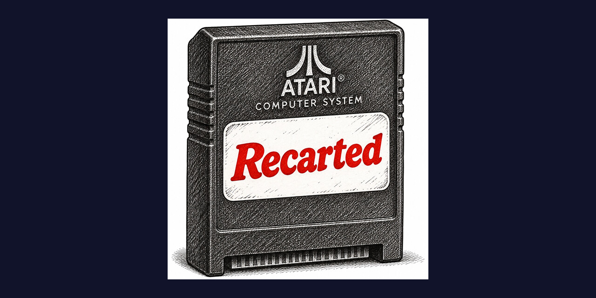

# ReCarted!



Give an Atari cassette or floppy a second life in the cartridge slot. ReCarted is a **Linux command-line converter for the Atari 8-bit XL/XE and A8PicoCart**. Give it a supported `.cas` cassette, `.atr` floppy, or `.atx` track image and it writes a new cartridge file. It never overwrites your original.

## Try it in a minute (no game images needed)

Install [uv](https://docs.astral.sh/uv/getting-started/installation/) and Git on Linux, then:

```sh
uv tool install git+https://github.com/feoh/recarted.git
recarted example rainbow.cas
recarted inspect rainbow.cas
recarted convert rainbow.cas
recarted inspect rainbow.car
```

If the shell can't find `recarted`, run `uv tool update-shell` and open a new terminal. Python 3.11 or newer is required; uv can supply it. No assembler is needed. Only the two emulator-assisted ATX recipes require Atari800 and an Atari OS ROM.

The example is an original Atari program that displays colour bars. Try `recarted example rainbow-disk.atr` for the floppy equivalent, or `recarted example rainbow-track.atx` to try the ATX workflow without an emulator or ROM. Use distinct names: both `rainbow.cas` and `rainbow.atr` would otherwise want to write `rainbow.car`.

## Convert your own image

```sh
recarted recipes
recarted inspect 'Gridrunner.cas'
recarted convert 'Gridrunner.cas'
recarted convert 'Bruce Lee.atr' --output 'Bruce Lee.xex'
```

`inspect` reads the contents, not the filename. `convert` writes a `.car` beside the source unless you choose `--output`. If the output already exists, choose a new name. For one-load games you can request `.xex` instead: the A8PicoCart loads that directly into RAM. For games that still need disk sectors, use `.car`.

| Source | Recognized games in 0.2 | Output |
| --- | --- | --- |
| Cassette (`.cas`) | Attack of the Mutant Camels, Gridrunner, Hover Bovver | CAR or XEX |
| Disk (`.atr`) | Bruce Lee (Datasoft, US a2) | CAR or XEX |
| Disk (`.atr`) | Jumpman (Epyx, US), Pinball Construction Set | CAR with a **read-only** virtual disk |
| Track disk (`.atx`) | Jumpman (Epyx, US) | CAR with a **read-only** virtual disk |
| Track disk (`.atx`) | The Tail of Beta Lyrae (Datamost), Bruce Lee | CAR; Atari800 + stock XL/XE OS revision 2 required |

These are **specific releases**, not every dump of each title. If `inspect` says “No matching recipe,” changing the name won't help. No commercial games, game data, or Atari OS ROMs are distributed with ReCarted. Use images you have the right to convert.

## Convert an ATX disk

Run `recarted inspect` first. If the disk is the recognized Jumpman release, `recarted convert 'Jumpman (1983)(Epyx)(US)[!].atx'` works directly. For *The Tail of Beta Lyrae* and *Bruce Lee*, install Atari800 with its text monitor (tested with 5.2.0) and supply your own stock 16 KiB XL/XE OS revision 2 ROM. For example, from the directory containing the game and `ATARIXL.ROM`:

```sh
recarted inspect 'Tail of Beta Lyrae (The) _ Datamost.atx'
recarted convert 'Tail of Beta Lyrae (The) _ Datamost.atx' --os-rom ATARIXL.ROM
```

ReCarted boots a temporary copy of the original track image in the background. The resulting `.car` needs neither the disk nor that ROM file on the cartridge. An unknown dump isn't flattened into an ATR; it may need the disk's duplicate sectors, timing or error status. If you're upgrading the Git-based install, run `uv tool upgrade recarted`.

## Play it

- **A8PicoCart:** With the cartridge **removed from the Atari**, connect it to the computer over USB. Copy the resulting `.car` or `.xex` to it, eject it, and **disconnect USB before inserting it into the powered-off Atari**. Power on, select the file normally, and it boots straight into the program. No DiskCart menu or disk in D1: is needed.
- **Linux emulator:** Install `atari800` separately and run `recarted test rainbow.car`. For the disk-reader games, use a stock XL/XE OS: `recarted test 'Jumpman.car' --os-rom ATARIXL.ROM` (supply the path to your own ROM). The command opens Atari800 so **you** can check the screen and controls; it does not claim the game passed just because the emulator started. For XEX, use `atari800 -xl -nobasic -run 'Bruce Lee.xex'`.

**Can I save a pinball table?** Not to the embedded cartridge disk. Use your original ATR in a writable disk setup for authoring and saving.

**“Unsupported Cartridge Type”?** Run `recarted inspect` on the file you actually copied. ReCarted generates **type 41, 128 KiB** (Atarimax **1 Mbit**). The older type 42 is **1 MiB / 8 Mbit** and is not supported by stock A8PicoCart. Renaming a ROM or editing that header byte doesn't fix it. If type 41 is rejected, tell us your cartridge model and firmware version.

## What's next?

More **cassette** recipes are a priority, especially multi-stage tapes such as Preppie! and the two sides of International Karate. Additional ATX releases, more floppy layouts, and tested **macOS and Windows** installations are also on the roadmap. WAV recordings, raw ROMs, and arbitrary disk/tape ports are not supported.

## Contribute a recipe

Got another Atari disk or tape running from a cartridge? [Send a pull request](https://github.com/feoh/recarted/compare) with your recipe. ATX, ATR, and CAS recipes are all welcome, including ones for a different release of a game we already support. Tell us which release you converted and what you saw when you booted it in Atari800 or on hardware. Share the recipe and the image’s SHA-256, not the commercial image or OS ROM. See [how to add and verify a recipe](docs/TECHNICAL.md#verification-and-adding-recipes) for the testing details.

[Request a recipe or report a hardware result](https://github.com/feoh/recarted/issues): include the title and release, `recarted inspect` output, the source's `sha256sum`, your Atari/cart model and firmware, and what you saw. Please **don't attach commercial images or OS ROMs**.

For how recognition works, emulator evidence, limitations, or building and testing the loaders, see [Technical notes](docs/TECHNICAL.md). [MIT license](LICENSE).
